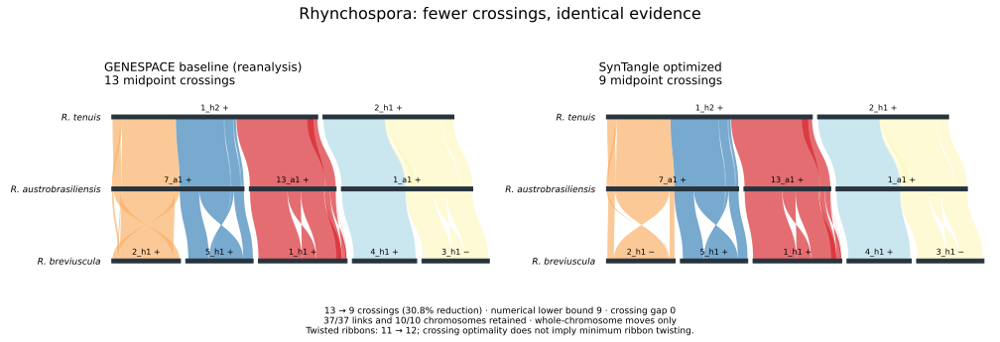

<p align="center">
  
</p>

# SynTangle

[](https://github.com/Hanliconius/SynTangle/actions/workflows/release-install.yml)
[](https://github.com/Hanliconius/SynTangle/actions/workflows/core-tests.yml)
[](LICENSE)

**Improve chromosome synteny plots while preserving every supplied link.**

SynTangle changes the placement and orientation of whole chromosomes to reduce tangled synteny layouts. Internal coordinates and species row order stay fixed: chromosomes are never cut or rearranged internally.

| Choose | What it does | R / command line |
|---|---|---|
| **GENESPACE flip helper** | Adds orientation improvement to an existing GENESPACE plot, keeping its chromosome order | `syntangle_flip_assist()` / `syntangle flip-assist` |
| **Full SynTangle** | Independently optimizes chromosome order and orientation from supplied synteny evidence | `syntangle_run()` / `syntangle run` |

The flip helper is a SynTangle add-on for GENESPACE. Full SynTangle can use GENESPACE products or other supported inputs. Neither workflow repeats homology discovery.

**[Full user guide →](docs/user-guide/walkthrough.md)** — how the method works, allowed moves, ribbon refinement, and interpreting results.



**55 → 9 midpoint crossings: an 83.6% reduction.** All 37 links, all 10 chromosomes and their internal coordinates are retained. The numerical solver reports a lower bound of **9**, matching the final score (**gap 0**) for this crossing model. This is solver-bound closure, not an independently checked exact certificate.

The left panel is the initial sequence-order display from our three-genome reanalysis; the right is the optimized layout. The initial order is not asserted to match the published figure exactly. The improvement and bound apply to **midpoint crossings**. [Data, provenance and reproduction commands](examples/rhynchospora/README.md).

**Source paper:** Zhang et al. (2026), *Sex without crossovers mimics clonal reproduction in Rhynchospora tenuis*, Nature. [doi:10.1038/s41586-026-11057-7](https://doi.org/10.1038/s41586-026-11057-7). This example reanalyses the three species shown in Fig. 1a.

## Install

Requirements: **Python 3.11+** and Git. For the R interface, also install **R 4.1+**. GENESPACE is needed only when using GENESPACE products. Python remains required when calling SynTangle from R.

Run these commands in a terminal (the activation command shown is for Bash/Zsh):

```bash
git clone --depth 1 --branch main https://github.com/Hanliconius/SynTangle.git
cd SynTangle
python3 -m venv .venv
source .venv/bin/activate
python -m pip install '.[optimization,plotting]'
syntangle --version
```

To use SynTangle inside R, also run this from the repository directory:

```bash
R CMD INSTALL r/SynTangleR
```

If RStudio cannot find the Python environment, pass `executable="/absolute/path/to/SynTangle/.venv/bin/syntangle"` to either R function. In a new terminal, reactivate the environment before using the CLI.

**Early public preview:** Python `0.1.0rc1`, R interface `0.1.0`. Install from this repository; packages are not yet on PyPI, CRAN or Bioconda. Linux is tested in CI; other platforms are not yet validated. See [troubleshooting](docs/user-guide/troubleshooting.md) for installation help.

Feedback and reproducible bug reports are welcome through [GitHub Issues](https://github.com/Hanliconius/SynTangle/issues/new?template=bug_report.md). Include your command or R call, software versions and a small shareable example. The R adapter targets the GENESPACE 1.3.1 data schema; native end-to-end validation across GENESPACE versions is still in progress.

## Use your existing GENESPACE results from R

Keep the object returned by `plot_riparian()`. Here, `gsParam` is your existing completed GENESPACE run:

```r
library(GENESPACE)
library(SynTangleR)

rp <- plot_riparian(gsParam = gsParam, useRegions = TRUE, useOrder = FALSE)

# Helper: preserve GENESPACE's chromosome order, improve orientations.
flipped <- syntangle_flip_assist(
    rp, useOrder = FALSE, output = "results/flip_assist"
)
flipped$stats
flipped$invertTheseChrs

# Full optimizer: search chromosome order and orientations.
full <- syntangle_run(
    rp, useOrder = FALSE, output = "results/syntangle", seconds = 600
)
full$stats
full$layout
full$pdf
```

For the flip helper, replot with your original GENESPACE arguments and replace `invertTheseChrs` with `flipped$invertTheseChrs`. Keep all ordering arguments unchanged. For **full SynTangle**, use its PDF or complete layout: applying only its flips in GENESPACE will not apply the optimized chromosome order.

`useOrder` must match the original plot. If it already used inversions, pass that original list into SynTangle too; the returned list replaces it rather than being appended. See the [GENESPACE/R guide](docs/user-guide/genespace.md) for complete replotting examples.

## Try it without GENESPACE or genome downloads

From the repository directory, run the bundled **Rhynchospora real-data example** (all 37 regions; no downsampling):

```bash
syntangle flip-assist \
  --chromosomes examples/rhynchospora/chromosomes.tsv \
  --links examples/rhynchospora/links.tsv \
  --output results/example_flips --figure

syntangle run \
  --chromosomes examples/rhynchospora/chromosomes.tsv \
  --links examples/rhynchospora/links.tsv \
  --output results/example_full --seconds 20 --figure
```

Output directories must be new or empty. Starting from its GENESPACE layout, both workflows reach 9 crossings from 13, retaining all 37 links and 10 chromosomes. Full optimization closes its numerical crossing bound on this example. The illustrated sequence-order baseline has 55 crossings. This is our three-genome reanalysis, not the paper's full twenty-genome discovery. Search results can depend on the budget and software environment.

## How it works

Treat a chromosome as a rigid strip: move it as a whole, or turn the entire strip around. A flip maps every coordinate x to L-x on a chromosome of length L. Every link remains attached to its original interval.

The standard score counts pairs of links whose **midpoint order reverses** between adjacent species rows. The flip helper repeatedly accepts improving orientation changes. Full SynTangle combines local neighborhood searches with mixed-integer optimization over chromosome order and orientation, retaining a feasible layout and a lower bound.

A ribbon can still twist even with few midpoint crossings. Full SynTangle offers optional `ribbonObjective="crossing-cap"` refinement to reduce twists without increasing the crossing score reached by the initial search. `"combined"` permits a trade-off between crossings and twists. These options are separate from standard flip assistance; see [ribbon refinement](docs/user-guide/walkthrough.md#why-a-low-crossing-score-can-still-look-tangled).

## What you get

| Output | Purpose |
|---|---|
| Vector comparison PDF | Inspect the starting and final layouts |
| `layout.tsv`, `flips.tsv` | Final chromosome ranks/orientations and flips relative to the input |
| `stats.json`, `summary.tsv` | Before/after crossings, twists, retained counts, runtime and optimality status |
| `pair_stats.tsv` | Check improvements or trade-offs for each adjacent species pair |
| `fixture.json`, `input_layout.tsv` | Preserve the supplied evidence and starting layout |

R also returns these results and saves `syntangle_result.rds`. Full-search diagnostics are saved separately. See the [complete output reference](docs/user-guide/usage.md#outputs).

**Reading the scores:** smaller crossing counts are better for the crossing objective. If the final score is U and the lower bound is L, the remaining gap is U-L. For example, U=300 and L=280 leave at most 20 crossings of possible improvement, subject to the bound's validity. Flip assistance is heuristic and provides no optimality certificate. `solver_bound_closed` means a matching numerical solver bound, **not an independently verified exact proof**. These are layout statistics, not p-values or estimates of evolutionary rearrangements.

## Inputs and further help

Canonical chromosome/link tables work independently of GENESPACE. **JCVI six-column `.simple` blocks with BED** and **minimap2 PAF** have experimental importers: synthetic tests pass, but real-data validation is outstanding.

- **[Full user guide](docs/user-guide/walkthrough.md)**
- [GENESPACE and R workflows](docs/user-guide/genespace.md)
- [Input tables](docs/user-guide/inputs.md) and [experimental importers](docs/user-guide/importers.md)
- [Commands and statistics](docs/user-guide/usage.md), [methods](docs/user-guide/methods.md) and [troubleshooting](docs/user-guide/troubleshooting.md)
- [Contributing and tests](CONTRIBUTING.md) · [Changes](CHANGELOG.md)

Report reproducible problems through [GitHub Issues](https://github.com/Hanliconius/SynTangle/issues). Cite the software using [CITATION.cff](CITATION.cff), and cite GENESPACE and original data sources separately where applicable.

Copyright Joseph Hanly and contributors. Released under the [MIT license](LICENSE).
