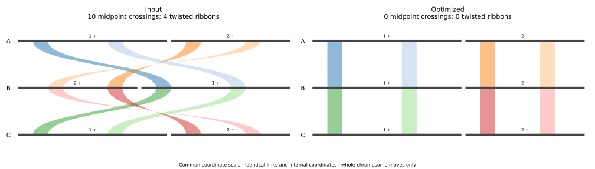

# SynTangle

**Improve chromosome synteny layouts while preserving the underlying evidence.**

**GENESPACE flip assistance** is an add-on for an existing GENESPACE layout: it keeps chromosome order fixed and improves whole-chromosome orientations. **Full SynTangle** is a separate layout optimizer that searches chromosome order as well as orientation, using GENESPACE products or explicit synteny tables. Neither workflow repeats homology discovery. Every supplied link and its within-chromosome coordinates remain fixed.

Start with the **[user guide](docs/user-guide/walkthrough.md)** for what changes physically, how the search works, why midpoint crossings and ribbon twists differ, and how to interpret the output statistics.

| Workflow | R function | Command line | Allowed changes |
|---|---|---|---|
| GENESPACE flip helper | `syntangle_flip_assist()` | `syntangle flip-assist` | Whole-chromosome flips; fixed order |
| Full SynTangle | `syntangle_run()` | `syntangle run` | Chromosome permutations and whole-chromosome flips |

Both workflows report before/after crossing counts, per-species-pair counts, the resulting layout, and retained link counts. Full SynTangle also reports a crossing lower bound and remaining optimality gap. Optional ribbon refinement accounts for twisted ribbons as well as midpoint crossings.

**Release candidate:** Python `0.1.0rc1`, R interface `0.1.0`. Install from this repository. Packages are not yet published on PyPI, CRAN or Bioconda. Linux is tested in CI; other platforms are not yet validated.

## Install

Python 3.11 or newer is required. R users also need R 4.1 or newer and their existing GENESPACE installation.

```bash
git clone --depth 1 --branch release-candidate-0.1 https://github.com/Hanliconius/SynTangle.git
cd SynTangle
python3 -m venv .venv
source .venv/bin/activate
python -m pip install '.[optimization,plotting]'
```

For the R interface, install the bundled package from the repository directory:

```bash
R CMD INSTALL r/SynTangleR
```

The R interface calls the same Python engine as the command line. If RStudio cannot find the activated environment, supply `executable="/absolute/path/to/SynTangle/.venv/bin/syntangle"` to either R function.

## Use from R with GENESPACE

Keep the returned object from your existing `plot_riparian()` call. For example:

```r
library(GENESPACE)
library(SynTangleR)

rp <- plot_riparian(gsParam = gsParam, useRegions = TRUE, useOrder = FALSE)

flipped <- syntangle_flip_assist(
    rp, useOrder = FALSE, output = "results/flip_assist"
)
flipped$stats
flipped$invertTheseChrs

full <- syntangle_run(
    rp, useOrder = FALSE, output = "results/syntangle", seconds = 600
)
full$stats
full$layout
full$pdf
```

`useOrder` must match the original GENESPACE plot. If that plot already uses `invertTheseChrs`, pass the same list to SynTangle. The returned inversion list is the **complete replacement list**, not an additional set of flips. See the [GENESPACE guide](docs/user-guide/genespace.md) for replotting, existing inversions, preserved chromosome order, and coordinate conventions.

## Try a complete example

The bundled example needs no genome downloads or GENESPACE installation:

```bash
syntangle flip-assist \
  --chromosomes examples/quickstart/chromosomes.tsv \
  --links examples/quickstart/links.tsv \
  --output results/example_flips --figure

syntangle run \
  --chromosomes examples/quickstart/chromosomes.tsv \
  --links examples/quickstart/links.tsv \
  --output results/example_full --seconds 10 --figure
```

Each output directory contains a layout, statistics, original evidence, a flip list, and a vector comparison PDF when `--figure` is requested. Output directories must be new or empty, preventing accidental replacement of prior results.



## Ribbon refinement

Crossing counts use link midpoints. A wide ribbon can twist internally without changing that count. To improve ribbon appearance after the crossing search while keeping its crossing count from increasing:

```r
full <- syntangle_run(
    rp, useOrder = FALSE, output = "results/ribbon_refined",
    seconds = 600, ribbonObjective = "crossing-cap",
    twistMetric = "width", ribbonSeconds = 300
)
```

The equivalent CLI options are `--ribbon-objective crossing-cap --twist-metric width --ribbon-seconds 300`. The optional `combined` objective permits a documented trade-off between crossings and twists. It is not the standard flip-assist objective.

## Other inputs

GENESPACE is optional: the two-table input works with any source of explicit directed synteny intervals. Experimental importers also accept **JCVI six-column `.simple` blocks plus BED** and **minimap2 PAF**. These importers have synthetic tests but are **not yet validated on real datasets**. See [formats, conversion commands and limitations](docs/user-guide/importers.md).

## Documentation

- **[Start here: user guide and worked statistical interpretation](docs/user-guide/walkthrough.md)**

- [GENESPACE and R workflows](docs/user-guide/genespace.md)
- [Experimental JCVI and PAF importers](docs/user-guide/importers.md)
- [Input tables and coordinate conventions](docs/user-guide/inputs.md)
- [Commands, outputs and statistics](docs/user-guide/usage.md)
- [Methods and optimality claims](docs/user-guide/methods.md)
- [Troubleshooting](docs/user-guide/troubleshooting.md)
- [Contributing and tests](CONTRIBUTING.md)
- [Changes](CHANGELOG.md)

## Interpretation

SynTangle optimizes the supplied links and permitted chromosome moves. It does not infer biological rearrangements, repair assemblies, or establish that a published figure was biologically incorrect. A lower crossing count is a layout improvement under the chosen objective.

`solver_bound_closed` means the numerical solver's bound matches the observed crossing count for the encoded model. It is distinct from an independently checked mathematical certificate. Standard flip assistance is heuristic. See [Methods](docs/user-guide/methods.md) for the precise scope.

## Support and citation

Report reproducible problems through [GitHub Issues](https://github.com/Hanliconius/SynTangle/issues), including the version, command or R call, and a small shareable input. Use [CITATION.cff](CITATION.cff) to cite the software; cite GENESPACE and the original data sources separately when applicable.

Copyright Joseph Hanly and contributors. Released under the [MIT license](LICENSE).
